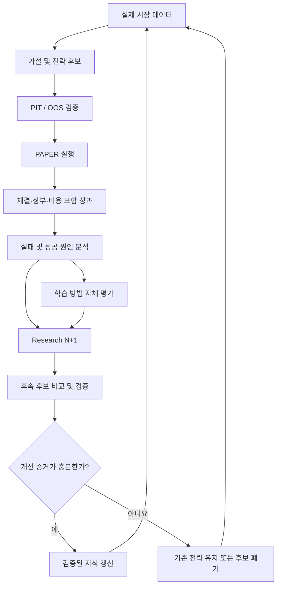

# NUSA 최상위 학습능력: 재귀적 자기개선 투자 지능 (Recursive Self-Improving Investment Intelligence)

상태: 소유자 정의(2026-10-13). 이 문서는 개념과 현재 구현 지도입니다. 어떤 권한도 부여하지 않습니다.
`PAPER_ONLY`, `liveAuthority=NONE`, `productionMutationAllowed=false`, `aiAuthority=ZERO_AUTHORITY`는 그대로입니다.

## 최종 정의
> NUSA의 최상위 학습능력은 실제 시장의 결과를 통해 투자 지식뿐 아니라 지식을 얻는 방법까지 지속적으로 개선하고, 그 개선의 유효성을 독립적인 증거로 검증하는 재귀적 자기개선 능력입니다.

- 이것은 과거 거래를 기억하거나 수익률이 높은 전략을 찾는 능력과 다릅니다.
- 검증된 지식만 다음 학습 사이클의 출발점이 됩니다. 검증된 지식이란 비용 포함 성과, 신뢰도, 적용 조건, 실패 조건, 재현 가능한 증거를 갖춘 지식입니다.
- 자동으로 학습한다고 해서 실전 거래 권한이 생기지는 않습니다. AI는 탐색·분석·개발을 돕고, 거래·위험·승인은 결정적 규칙이 통제합니다.

## 재귀 루프

## 8가지 능력과 현재 구현 지도 (2026-10-13, 코드와 운영 `/health` 기준)
상태 표기:
- 연결됨: 코드가 있고 실제 루프에서 동작함
- 있으나 미연결: 코드는 있으나 루프에 연결되지 않음
- 부분: 일부만 있음
- 없음: 코드가 없음

괄호 안의 미검증은 이번에 동작을 직접 확인하지 않았다는 뜻입니다.

| 능력 | 지금 있는 것 | 상태 | 빈칸 |
|---|---|---|---|
| 자기 관찰 | PAPER 장부, 손실 귀속(`paperLossAttribution.ts`), 기준 전략 SHADOW(`paperBaselineShadow.ts`), `/health` 관측 | 연결됨 | owner baseline 기간은 Research 계보가 없어 학습 사이클 기록으로 이어지지 않음 |
| 인과 추론 | 후보 실패 귀속(`candidateFailureAttribution.ts`), 국면별 OOS 귀속(`regimeOosAttribution.ts`), 실패 사유(`researchFailureMemory.ts`) | 부분(미검증) | 손익을 신호·비용·체결 품질로 분해하는 단일 보고가 없음 |
| 가설 생성 | Research 실험 그리드(`researchExperimentComposition.ts`, SMA/RSI/돈치안 고정 격자) | 부분 | 새 계열·새 데이터·학습형 모델을 스스로 제안하지 못함 |
| 엄격한 반증 | 후보 게이트(최소 거래 50), DSR/PBO 증거, 홀드아웃 원장; 오프라인 사전등록 연구 | 연결됨(오프라인) | 사전등록·누적 다중검정 보정이 런타임 Research에는 없음 |
| 전이학습 | 없음 | 없음 | 한 시장의 지식을 다른 시장에서 검증하는 절차 |
| 온라인 적응 | 시장 국면 엔진(`marketRegimeEngine.ts`), 시간 단위 평가 | 부분(미검증) | 성능 저하 감지 → 재평가 시점 결정이 루프에 연결되지 않음 |
| 메타학습 | 연구 장부와 메타 학습기(`docs/research-ledger/experiments.json`, `scripts/research-meta-learner.js`) | 부분(오프라인) | 런타임 Research가 메타 학습기의 선택을 아직 받지 않음 |
| 지속적 자기개선 | League 비교(`nusaLeague.ts`), 승격 게이트(`researchPromotionGate.ts`), 폐루프 코디네이터 | 있으나 미연결 | 검증 통과 후보가 없어 한 번도 실제로 돌지 않음(`cyclesRecorded=0`) |

## 현재 가장 먼저 끊기는 곳
- **Research → 검증 통과 후보**: 오늘까지 사전등록 실험 7건, 설정 173개 중 홀드아웃 통과 0개입니다. 1차 통과 14개는 모두 처음 보는 데이터에서 무너졌습니다.
- **PAPER 성과 → 학습 사이클**: owner baseline의 실현 기간 10개가 계보 부재로 기록되지 않습니다. 계보를 꾸미는 것은 금지입니다.

정의대로 첫 단계는 더 큰 모델이 아니라 이 단절을 정직하게 잇는 것입니다. 후보 방안(소유자 결정 필요):
- baseline 기간을 "관찰 기록(OBSERVATION_ONLY)"으로 영속 저장하고 Research N+1의 실패 귀속 입력으로 씁니다. 검증 통과나 계보 주장은 하지 않습니다.

## 학습능력 측정 지표
| 영역 | 지표 | 지금 측정 가능한가 |
|---|---|---|
| 투자 성과 | 비용 포함 OOS/PAPER 성과, 위험 조정 성과, 낙폭 | 부분(오프라인 연구, PAPER 장부) |
| 학습 효율 | 유효 가설 비율, 실험당 비용 | 예: 연구 장부(유효 0/173) |
| 일반화 | 미사용 데이터·다른 국면 성능 | 예: 홀드아웃 결과 |
| 적응력 | 국면 변화 감지 시간, 회복 후 재검증 | 아니오 |
| 신뢰성 | 재현성, 무결성, 재시작 후 증거 보존 | 부분(#2589 필드 배포, 실제 사이클 없음) |
| 메타학습 | 이전 방법보다 유효 지식을 더 효율적으로 얻는가 | 장부 축적 후 가능 |

수익률 하나로 학습능력을 평가하지 않습니다. 여러 독립 검증에서 재현되는 개선만 개선으로 인정합니다.
